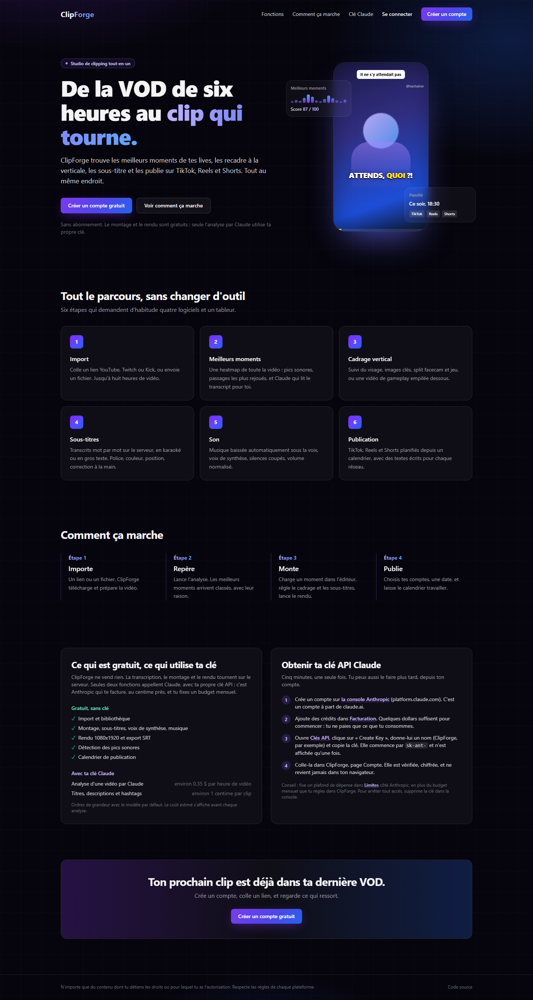

# Hooklip

Studio de clipping : importer une VOD ou une vidéo, repérer les meilleurs moments, monter des clips verticaux et les publier.



État actuel : **phase 6**, la dernière du plan.

- Phase 1 (socle) : comptes par email et mot de passe, clé API Claude ajoutée dans le compte, import par URL ou par fichier, file de jobs, bibliothèque avec progression en temps réel, page Utilisation.
- Phase 2 (clip de base) : découpe d'un extrait, recadrage vertical 9:16, sous-titres karaoké mot par mot, voix de synthèse en option, musique de fond, rendu 1080x1920 H.264/AAC, export SRT.
- Phase 3 (éditeur complet) : cadrage manuel par images clés, split facecam/jeu, vidéo secondaire empilée, styles de sous-titres et correction du texte, accroche, filigrane, barre de progression, zoom sur les pics sonores, coupe des silences, normalisation du volume, miniature, templates, aperçu vertical en direct.
- Phase 4 (détection) : score des meilleurs moments par tranche de 10 secondes (volume sonore, « Most replayed » de YouTube, clips des viewers Twitch, lecture du transcript par Claude), heatmap cliquable, clips candidats à charger dans l'éditeur ou à rejeter, coût Claude estimé avant et compté après.
- Phase 5 (publication) : connexion de comptes YouTube, TikTok et Instagram par OAuth, textes de publication et score proposés par Claude, planification par compte, publication automatique par le worker, calendrier et liste avec statut, lien du post, nouvelle tentative et téléchargement de secours.
- Phase 6 (finitions) : tableau de bord, statistiques des posts, clips par lots, suppression automatique des vidéos d'origine, mot de passe oublié par email, email en cas d'échec de publication.

## Architecture

```
web/      Next.js : interface, actions serveur, routes API, Prisma
worker/   Python : exécute les jobs (yt-dlp, FFmpeg, faster-whisper, OpenCV, Piper)
postgres  données + file de jobs (table "Job")
data/     fichiers, partagés entre web et worker :
          data/{userId}/sources/{sourceId}/, data/{userId}/clips/{clipId}/ et data/{userId}/music/
```

- Le web crée une ligne dans `Job`. Le worker la prend (`FOR UPDATE SKIP LOCKED`), écrit sa progression dans `Job.progress`.
- Le navigateur suit la progression par SSE (`/api/events`), qui relit la base chaque seconde.
- Un seul job à la fois par utilisateur. Trois tentatives par job, puis statut `error` avec la raison.

## Rendu d'un clip

Les réglages d'un clip sont un objet JSON (`Clip.edit`), décrit et validé dans `web/lib/edit.ts`. Le job `render` du worker les applique :

1. **Transcription** de l'extrait avec faster-whisper (modèle `small`, en local), si les sous-titres, la voix de synthèse ou la coupe des silences en ont besoin. Le modèle (environ 500 Mo) est téléchargé au premier rendu, puis gardé dans le volume Docker `models`. Pour changer de modèle : `WHISPER_MODEL=medium` dans `.env`. Si l'utilisateur a corrigé les mots à la main, ils sont repris tels quels.
2. **Cadrage**, quatre modes :
   - suivi du visage : une mesure par seconde (OpenCV), lissée pour que le cadre ne tremble pas ;
   - centre ;
   - manuel : le cadre glisse d'une image clé à la suivante ;
   - split : la zone de la facecam en haut, le jeu en bas.
   Hors split, une vidéo secondaire de la bibliothèque peut être empilée au-dessus ou en dessous (elle boucle, sans son). La part de hauteur de chaque partie est réglable.
3. **Texte incrusté** (un seul fichier ASS) : sous-titres (karaoké ou gros texte mot par mot ; police, taille, couleur, contour, position), accroche des 3 premières secondes, filigrane. Fichier SRT à part.
4. **Coupe des silences** : seules les parties parlées sont gardées (avec une petite marge) ; les sous-titres sont recalés.
5. **Zoom** sur les pics sonores : les moments les plus forts de l'extrait, un par tranche de 10 secondes au plus.
6. **Son** : voix de synthèse Piper (locale, sans clé) qui redit la transcription et remplace tout le son d'origine ; musique de fond (fichier de l'utilisateur, volume réglable, fondus, baissée quand ça parle) ; normalisation à -14 LUFS.
7. **Barre de progression**, puis **miniature** (une image du clip rendu).

Un clip rendu peut être refait : avec d'autres réglages, avec des sous-titres corrigés, ou en appliquant les réglages actuels à tous les clips de la source. Un **template** enregistre les réglages (sans les images clés, propres à un clip) pour les recharger plus tard.

La logique pure (cadre, silences, pics, texte, commandes FFmpeg) est dans `worker/render.py`, testée dans `worker/test_worker.py`. La validation des réglages est testée dans `web/lib/edit.test.ts`.

## Détection des meilleurs moments

Sur la page d'une source, « Analyser cette vidéo » lance un job `analyze`. Chaque signal disponible donne une valeur de 0 à 1 par tranche de 10 secondes ; le score (0 à 100) est leur moyenne pondérée.

| Signal | Source | Poids |
| --- | --- | --- |
| Claude | lit le transcript complet, par tranches de 25 minutes, et propose des moments avec titre, raison et note | 0,40 |
| « Most replayed » | courbe de YouTube, lue par yt-dlp quand elle existe | 0,35 |
| Clips des viewers | API officielle Twitch (Helix), si `TWITCH_CLIENT_ID` et `TWITCH_CLIENT_SECRET` sont renseignés | 0,30 |
| Volume sonore | pics de volume (cris, rires), toujours disponible | 0,20 |

- **Sans Claude** : gratuit, quelques secondes. Les candidats sont les pics du score.
- **Avec Claude** (case à cocher) : la source est d'abord transcrite en entier sur le serveur (compter à peu près sa durée), puis Claude lit le transcript avec la clé de l'utilisateur. Le coût estimé est affiché avant ; l'analyse est refusée s'il dépasse le budget mensuel restant, et s'arrête si le budget est atteint en cours de route. Chaque appel est enregistré dans `Usage` et apparaît dans Compte. Le transcript est gardé : relancer l'analyse ne retranscrit pas.
- Le modèle est `claude-opus-5-5` par défaut ; `CLAUDE_MODEL` dans `.env` permet d'en choisir un autre (`claude-sonnet-5-5`, `claude-haiku-5-5`). Les prix servant aux estimations sont dans `web/lib/cost.ts` et `worker/detect.py` : à mettre à jour si Anthropic les change.
- Twitch et Kick n'exposent pas de vraie courbe des moments les plus regardés. Le score y est une approximation, et l'interface le dit.

La logique pure (cases, normalisation, score, choix des pics, coût) est dans `worker/detect.py`, testée dans `worker/test_worker.py`.

## Publication

1. **Réseaux** : connecter un ou plusieurs comptes par réseau. Les jetons sont chiffrés en base comme la clé Claude, et renouvelés par le worker avant chaque publication.
2. **Publier** (bouton sur un clip rendu) : textes par réseau, à écrire ou à faire proposer par Claude dans la langue choisie (avec un score de potentiel, indicatif), comptes, date et heure.
3. Chaque publication est un job `publish` qui attend dans la file jusqu'à son heure. Trois tentatives si le réseau est indisponible ; un refus net (quota, autorisation, vidéo rejetée) n'est pas réessayé.
4. **Calendrier** : vue par mois et vue liste. Statuts : en attente, en cours, publié (avec le lien), brouillon TikTok à finir, échec (avec la raison, « Réessayer » et « Télécharger le clip » pour publier à la main). Le menu affiche le nombre d'échecs.

Ce que fait chaque réseau (documentations officielles de novembre 2026) :

| Réseau | Envoi | À savoir |
| --- | --- | --- |
| YouTube | envoi en deux temps (`videos.insert`, protocole « resumable ») | une vidéo verticale de 3 minutes au plus devient un Short ; 100 envois par jour et par projet par défaut |
| TikTok | Content Posting API, envoi du fichier par morceaux | tant que l'application n'est pas auditée par TikTok, les vidéos sortent en privé |
| Instagram | conteneur `REELS`, Instagram télécharge la vidéo, puis `media_publish` | compte professionnel ; le site doit être public en https ; 100 publications par 24 heures |

**Son TikTok.** L'API TikTok n'a aucun champ pour choisir un son de sa bibliothèque. Si le champ « Son TikTok » est rempli, la vidéo part en brouillon dans la boîte de réception TikTok du compte ; l'utilisateur l'ouvre dans l'appli, ajoute le son et publie. TikTok accepte 5 brouillons en attente par 24 heures.

**X (Twitter)** n'est pas branché : le bouton « Télécharger le clip » sert de secours pour les réseaux sans connexion.

## Suivi et confort

- **Tableau de bord** : sources, clips produits, publiés, planifiés, en échec, et le détail par compte. « Actualiser les statistiques » lance un job `stats` qui relit les vues et les « J'aime » des posts : YouTube donne les deux, Instagram les « J'aime » seulement, TikTok rien avec les droits demandés.
- **Clips par lots** : après une analyse, « Créer les meilleurs clips d'un coup » lance le rendu des 10 meilleurs moments au plus, avec les réglages de l'éditeur. Les rendus passent l'un après l'autre.
- **Suppression automatique** (Compte) : passé le nombre de jours choisi, la vidéo d'origine d'une source est supprimée pour libérer le stockage. Les clips rendus restent visibles, téléchargeables et publiables ; ils ne peuvent plus être refaits. Le worker vérifie toutes les dix minutes.
- **Emails** (facultatif, `SMTP_URL`) : lien de réinitialisation du mot de passe (valable une heure, une seule fois) et alerte quand une publication échoue. Sans serveur d'email, le lien de réinitialisation est écrit dans le journal du conteneur `web`, où l'administrateur peut le récupérer.

### Applications développeur

Chaque réseau demande une application créée par l'administrateur du site. Les identifiants vont dans `.env`, puis `docker compose up -d` pour les prendre en compte. `APP_URL` doit être l'adresse publique du site ; pour un essai depuis un poste local, un tunnel https (Cloudflare Tunnel, ngrok) fait l'affaire.

**YouTube**

1. [console.cloud.google.com](https://console.cloud.google.com) : créer un projet, activer « YouTube Data API v3 ».
2. « Écran de consentement OAuth » : type externe, ajouter les champs d'application `youtube.upload` et `youtube.readonly`. Tant que l'application est en test, seuls les comptes ajoutés comme testeurs peuvent se connecter.
3. « Identifiants » : créer un ID client OAuth de type « Application Web », avec l'URI de redirection `{APP_URL}/api/oauth/youtube/callback`.
4. Reporter l'ID et le secret dans `GOOGLE_CLIENT_ID` et `GOOGLE_CLIENT_SECRET`.
5. Avant une ouverture au public : faire valider l'écran de consentement par Google, et vérifier dans la documentation de l'audit de conformité si les vidéos d'un projet non audité sont limitées.

**TikTok**

1. [developers.tiktok.com](https://developers.tiktok.com) : créer une application, ajouter les produits « Login Kit » et « Content Posting API ».
2. Demander les droits `user.info.basic`, `video.publish` et `video.upload`.
3. Déclarer l'URI de redirection `{APP_URL}/api/oauth/tiktok/callback`. TikTok n'accepte que du https : pas de `http://localhost`.
4. Reporter la clé et le secret dans `TIKTOK_CLIENT_KEY` et `TIKTOK_CLIENT_SECRET`.
5. Demander l'audit de la Content Posting API. Avant l'audit, tout ce qui est publié reste en visibilité privée.

**Instagram**

1. [developers.facebook.com](https://developers.facebook.com) : créer une application, ajouter le produit « Instagram », choisir « Connexion Instagram pour les entreprises ».
2. Droits : `instagram_business_basic` et `instagram_business_content_publish`.
3. Déclarer l'URI de redirection `{APP_URL}/api/oauth/instagram/callback`.
4. Reporter l'identifiant et le secret de l'application Instagram dans `INSTAGRAM_APP_ID` et `INSTAGRAM_APP_SECRET`.
5. En accès standard, seuls les comptes que tu gères peuvent se connecter. Pour d'autres comptes, demander l'accès avancé (examen de l'application par Meta).

## Lancer

Prérequis : Docker Desktop.

1. Copier `.env.example` en `.env`.
2. Remplir `MASTER_KEY` et `SERVER_SALT`. Pour générer chaque valeur :

```bash
node -e "console.log(require('crypto').randomBytes(32).toString('hex'))"
```

3. Démarrer :

```bash
docker compose up --build
```

4. Ouvrir http://localhost:3000, créer un compte (email et mot de passe), puis ajouter sa clé API Claude dans Compte. La page d'accueil et la page Compte expliquent comment en obtenir une sur [platform.claude.com](https://platform.claude.com/settings/keys).

### Sans clé API : le mode abonnement

Sur une instance que tu fais tourner pour toi, Claude peut passer par ton abonnement Claude (Pro, Max…) au lieu d'une clé API facturée à l'usage :

1. Installer [Claude Code](https://code.claude.com/docs/en/setup) sur ta machine et lancer `claude setup-token`. La commande ouvre le navigateur, puis affiche un jeton valable un an.
2. Dans `.env`, mettre ce jeton dans `CLAUDE_CODE_OAUTH_TOKEN` et l'email de ton compte Hooklip dans `SUBSCRIPTION_EMAIL`.
3. Relancer : `docker compose up -d`.

Le worker et le web appellent alors Claude Code (`claude -p`) pour ce compte : pas de coût à l'appel, les analyses consomment ton quota d'abonnement, partagé avec ton usage habituel de Claude. Le budget mensuel ne s'applique plus ; les appels restent comptés dans Compte.

Ce mode ne vaut que pour le compte `SUBSCRIPTION_EMAIL`. Les [conditions d'Anthropic](https://code.claude.com/docs/en/legal-and-compliance) interdisent à un service de faire passer ses utilisateurs par un abonnement, ou de leur proposer une connexion claude.ai : sur une instance ouverte au public, tous les autres comptes utilisent leur propre clé API.

Ne change jamais `MASTER_KEY` après la première utilisation : les clés Claude et les jetons des réseaux, chiffrés avec elle, deviendraient illisibles. `SERVER_SALT` signe les liens de vidéo donnés à Instagram.

## Mettre en ligne

Sur un serveur Linux avec Docker et [Traefik](https://traefik.io) déjà lancé (réseau `host`, fournisseur Docker, résolveur Let's Encrypt nommé `letsencrypt`, entrée `websecure`), comme le modèle « Docker and Traefik » d'Hostinger. Prévoir 4 cœurs et 8 Go de RAM.

1. Faire pointer le nom de domaine et son `www` (deux enregistrements `A`) vers l'adresse IP du serveur. `www` est redirigé vers le domaine.
2. Copier le projet sur le serveur, puis `.env.example` en `.env`.
3. Dans `.env` : `MASTER_KEY`, `SERVER_SALT` et `POSTGRES_PASSWORD` (trois valeurs aléatoires différentes, générées par `openssl rand -hex 32`), `DOMAIN=mon-domaine.fr` et `APP_URL=https://mon-domaine.fr`.
4. Lancer :

```bash
docker compose -f docker-compose.yml -f docker-compose.prod.yml up -d --build
```

Traefik obtient le certificat HTTPS tout seul à la première visite. En production, la base et le port 3000 ne sont pas exposés : seul Traefik joint le site. Le worker est limité à `WORKER_CPUS` cœurs (3 par défaut) pour que les rendus ne ralentissent pas les autres sites du serveur.

Pour mettre à jour : copier la nouvelle version du code, puis relancer la même commande. Les migrations de la base s'appliquent au démarrage du web.

## Développer le web hors Docker

Plus rapide pour modifier l'interface (rechargement à chaud) :

```bash
docker compose up postgres worker
```

```bash
cd web && cp ../.env .env && npm install && npx prisma migrate dev && npm run dev
```

## Tests

```bash
cd web && npm test
```

```bash
docker compose run --rm --no-deps worker python -m unittest -v
```

Le même vecteur de chiffrement est vérifié des deux côtés : ce que le web chiffre, le worker sait le déchiffrer.

## Sécurité

- Comptes : email et mot de passe. Le mot de passe est haché avec scrypt et un sel par compte, jamais stocké en clair. Changer de mot de passe déconnecte les autres appareils.
- La clé Claude est facultative et ajoutée après l'inscription. Elle est vérifiée auprès d'Anthropic, chiffrée en base (AES-256-GCM avec `MASTER_KEY`) et jamais renvoyée au navigateur. Sans clé, l'analyse par Claude et les textes de publication sont désactivés ; le reste fonctionne.
- Session : jeton aléatoire dans un cookie httpOnly, seul son hash est en base.
- Chaque requête filtre par utilisateur ; les fichiers ne sont servis qu'à leur propriétaire.
- Inscription, connexion, changement de mot de passe et de clé : 5 tentatives par minute et par adresse IP au total.

## Limites connues

- L'adresse email n'est pas vérifiée à l'inscription.
- La migration `accounts` supprime les anciens comptes identifiés par leur seule clé Claude (ils n'avaient pas d'email pour se reconnecter).
- Le coût Claude affiché est une estimation calculée à partir des tokens consommés, pas la facture d'Anthropic.
- Publication : code écrit d'après les documentations officielles et testé contre de faux serveurs qui imitent Google, TikTok et Instagram, jamais contre les vraies plateformes (il faut des applications développeur).
- Publication : X non branché. Statistiques : pas de vues pour Instagram, rien pour TikTok.
- TikTok : si l'envoi réussit mais que la vérification finale échoue, la publication est marquée comme envoyée sans lien, pour ne jamais publier deux fois.
- Densité du chat Twitch / Kick : pas prise en compte. Aucune API officielle ne donne le chat d'une rediffusion.
- Clips des viewers Twitch : code écrit d'après la documentation Helix, jamais exécuté contre la vraie API (il faut des identifiants d'application Twitch).
- Signal sonore : volume seulement, pas de reconnaissance des rires ou des cris.
- Un seul worker. Pour en lancer plusieurs, voir le commentaire `shortcut` dans `worker/worker.py`.
- Stockage sur disque local uniquement, pas de S3.
- Suivi du visage : détecteur Haar d'OpenCV, fiable sur les visages de face. Sans visage détecté, le cadre reste centré.
- Transcription sur processeur : compter environ la durée du clip. Un clip dure 180 secondes au maximum.
- Aperçu de l'éditeur : approximatif. Le suivi du visage, les zooms, la coupe des silences et le vrai texte des sous-titres ne se voient qu'au rendu.
- Split : la zone de la facecam se règle avec quatre curseurs, pas à la souris, et n'est pas détectée automatiquement.
- Coupe des silences : tout ce qui n'est pas de la parole est coupé, y compris un cri ou un rire sans mots.
- Sous-titres : pas d'emojis automatiques. La correction du texte passe par un premier rendu.
- Voix de synthèse : une voix française et une voix anglaise, choisies selon la langue détectée (français par défaut). Les mots surlignés suivent le rythme de la voix d'origine, pas exactement celui de la voix de synthèse.
- Musique : pas d'écoute avant rendu, fichiers non comptés dans le quota de stockage.
- Filigrane : texte seulement, pas de logo image. Miniature : image prise au tiers du clip, non réglable.

## Rappel

N'importe que du contenu dont tu détiens les droits ou pour lequel tu as l'autorisation. Respecte les conditions d'utilisation des plateformes.
